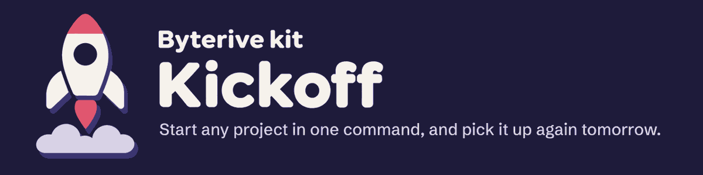
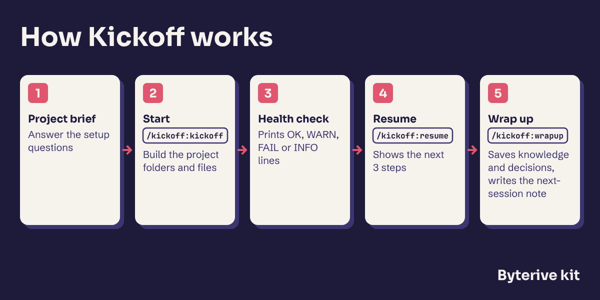
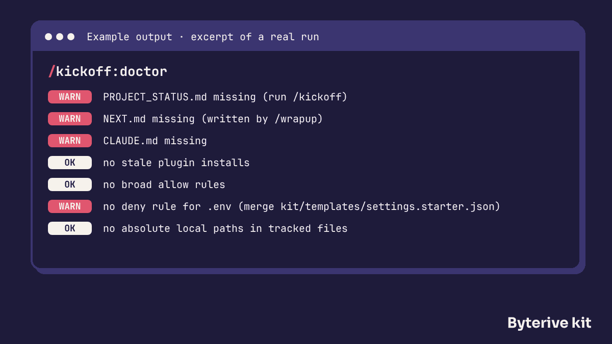

# kickoff

Start any project in one command, and pick it up again tomorrow.

Version 1.4.6 · MIT · Works with Claude Code

## What it does

We built kickoff to keep every Claude Code project readable and cheap to resume. Each document has a short header, each folder has an index, and a one-page status file tells a new session where to start. `/kickoff:kickoff <profile>` interviews you for a brief, asks which plugins and skills the project needs, and builds the folders, `CLAUDE.md`, `PROJECT_STATUS.md`, `DECISIONS.md`, `NEXT.md`, `.gitignore` and a git hook, then ends with a health check.

## How it works



1. Answer the setup questions, or fill in a project brief first.
2. `/kickoff:kickoff` builds the project folders and files.
3. The health check prints OK, WARN, FAIL or INFO lines.
4. Next day, `/kickoff:resume` shows the next 3 steps.
5. `/kickoff:wrapup` saves knowledge and decisions and writes the next-session note.

## Install

```
/plugin marketplace add Byterive/kit
/plugin install kickoff@byterive-kit
```

After a new version is released: `/plugin marketplace update byterive-kit`.

## Try it

1. `/kickoff:profiles`
   It lists the project profiles.
2. `/kickoff:kickoff --dry-run`
   It goes through the setup for a new project and writes nothing.
3. `/kickoff:doctor`
   It checks the project and prints one line per check: OK, WARN, FAIL or INFO, with the fix where one is needed.



## What you get

| command | what it does | result |
|---|---|---|
| `/kickoff:kickoff` | Starts a project end to end (`/kickoff:bootstrap` is an alias); `--dry-run` writes nothing | a ready project folder and a health report |
| `/kickoff:resume` | Reads where the last thread stopped | the next 3 steps |
| `/kickoff:checkpoint` | Light mid-session save of NEXT.md and PROJECT_STATUS.md (no reindex, no commit), so `/clear` then `/resume` is safe | one line: what it saved |
| `/kickoff:wrapup` | Saves knowledge and decisions, writes the next-session note | a list of changed files |
| `/kickoff:doctor` | Health check: status freshness, `CLAUDE.md` size, budgets, plugin set, stale installs, risky permissions | OK, WARN, FAIL and INFO lines |
| `/kickoff:upgrade` | Brings an older project up to this version; lists first, writes only after your yes, never overwrites | a TODO list, then the applied changes |
| `/kickoff:plugins` | Turns plugins and skills on or off for one project | the project's on and off list; `undo` restores it |
| `/kickoff:audit <profile>` | Read-only inventory of an existing project; writes only to `_audit/` | `_audit/SUMMARY.md` for your review |
| `/kickoff:status` | Summarizes `PROJECT_STATUS.md` | what is done, in progress, blocked and next |
| `/kickoff:reindex` | Rebuilds every `INDEX.md` and checks budgets | fixed or reported violations |
| `/kickoff:undo` | Removes what `/kickoff` created, if the files are still unchanged; dry run first | a list, then the removals |
| `/kickoff:profiles` | Lists the profiles as families, with aliases and what each adds | the profile list |
| `/kickoff:new-profile <name>` | Drafts a reusable profile from a finished project; saves only after you approve | a draft profile |

## Profiles

Profiles come in families, a main profile plus secondaries that add only what differs: backend (backend-go, backend-python, backend-rust, backend-node; the old name go-backend still works), frontend (frontend-react, frontend-vue), data-research (trading-research), utility (personal-utilities). Standalone: unity, netsuite, mobile-app, desktop-app, claude-plugin, or your own custom profile. `/kickoff:profiles` lists them.

## Hooks and agents

Three hooks run on your computer as Python scripts. Two safety hooks block recursive forced deletes and Claude co-author lines in commits, and a Stop hook regenerates the `INDEX.md` files in a kickoff project after each turn. Turn them off with `KICKOFF_DISABLED_HOOKS` (`rmrf`, `coauthor`, `reindex`, comma-separated).

Three review agents are included. `verifier` runs your build, test and lint commands and reports the real output; it never edits files. `backtest-skeptic` reviews trading backtests and ML results; it never edits files. `netsuite-engineer` helps with NetSuite customization and can edit files.

The full list is in the [how-to](https://github.com/Byterive/kit/blob/main/docs/howto/01-kickoff.md) and in `GUIDE.md`.

## Needs and limits

- Python 3 (standard library only) for the tools.
- Plugin switches are not available in Cowork projects.
- Profiles may suggest companion plugins by name, such as Unity's own skills and frontend-design. Those are third-party, not made or endorsed by us, and nothing is installed without your yes.
- The clarity rule (Claude asks first when a requirement is new) is advice to Claude, not a blocking hook.
- Privacy: see [PRIVACY.md](PRIVACY.md).

## Tests

```
python kit/tools/smoke_test.py
```

Other suites are in `kit/tools/` (`test_hooks.py`, `test_plan.py`, `test_safety.py`, `test_privacy.py`, `test_upgrade143.py`). Each exits 1 on any failure.

## Licence

License: MIT. Copyright (c) 2026 Junaid Iqbal (Byterive).

Unity and NetSuite are trademarks of their owners; this project is not affiliated with them.

*Independent project by Byterive. Not affiliated with or endorsed by Anthropic.* · [byterive.com](https://byterive.com)
